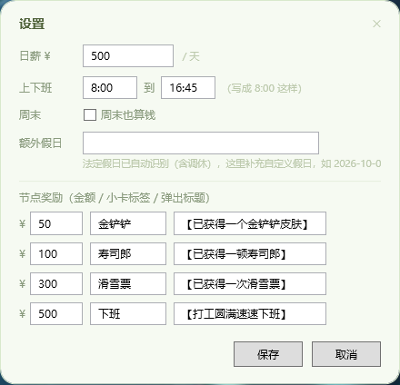

# 上班鼓励器 WorkEncourager 💰

> 一个用 **纯 PowerShell + WPF** 写的 Windows 桌面悬浮小组件：把你的日薪实时"拆"成小数跳动，看着钱一点点进账，打工都更有劲了。不依赖 Python、浏览器或任何第三方库。

[](#)
[](#)
[](#)
[](#)

## 📸 界面预览

**主界面** — 实时入账大字、进度条、里程碑卡片、本月累计：


**设置面板** — 所有参数 GUI 直接改，不用碰配置文件：



## ✨ 功能

- **实时入账动画** — 今日已赚金额按 25fps 实时滚动，小数末位一直在跳（日薪 ÷ 工时 ÷ 每帧）
- **进度条 + 下班倒计时** — 今日进度一目了然，精确到秒的「剩余 hh:mm:ss」
- **里程碑卡片** — 4 个自定义金额节点（默认 ¥50/¥100/¥300/¥500），达成变绿打勾并弹出气泡奖励：「已获得一个金铲铲皮肤 🎉」「已获得一顿寿司郎🍣」…… 文案随便改
- **本月累计** — 已打工天数 × 日薪 + 今日实时金额，附「相当于 xx」趣味换算
- **🇨🇳 法定假日自动识别** — 联网获取国务院节假日安排（[holiday-cn](https://github.com/NateScarlet/holiday-cn) 数据），法定假显示「不打工」，调休补班的周六日照常算钱；本地缓存 30 天，断网也能用
- **🎨 6 套主题** — 奶油粉 / 经典暗夜 / 抹茶拿铁 / 云朵蓝 / 蜜柚橙 / 葡萄汽水，右键即切；照抄几行就能加自己的主题
- **⚙️ 右键设置面板** — 日薪、上下班时间、周末计薪、额外假日、节点奖励金额与文案，全在 GUI 里改，不用碰配置文件
- **🖼️ 嵌入桌面模式** — 可钉在桌面最底层当"壁纸"用，点击不抢焦点，Win+D 显示桌面后自动回位
- **记住一切** — 窗口位置、主题、所有设置持久化到 `state.json`，重启不丢

## 🚀 快速开始

### 方式一：绿色版（免安装）

```powershell
git clone https://github.com/laomobiji/WorkEncourager.git
cd WorkEncourager
# 双击 start_widget.vbs 即可（静默启动，无黑框、不占任务栏）
```

> 如果提示脚本被禁止运行：右键 `start_widget.vbs` → 打开方式保持默认即可；启动器内部已带 `-ExecutionPolicy Bypass`。

### 方式二：安装包

到 [Releases](../../releases) 下载 `WorkEncourager-安装包.zip`，解压后运行 `安装.bat`：
程序装到 `%LOCALAPPDATA%\WorkEncourager\App`，自动创建桌面快捷方式，可选开机自启；配置存 `%APPDATA%\WorkEncourager`，升级不丢数据。卸载走 Windows「设置 → 应用」。

### 开机自启（可选）

`Win + R` → 输入 `shell:startup` → 把 `start_widget.vbs` 的快捷方式拖进去。

## 🛠️ 使用

| 操作 | 方式 |
|---|---|
| 移动窗口 | 按住窗口任意位置拖动，位置自动记住 |
| 打开菜单 | 右键窗口：主题 / 设置 / 嵌入桌面 / 刷新假日数据 / 退出 |
| 修改参数 | 右键 →「设置」，GUI 里改完点保存立即生效 |
| 切换主题 | 右键 →「主题」，6 套任选 |
| 当桌面壁纸 | 右键 →「嵌入桌面（当壁纸）」开/关 |

### 自定义节点奖励示例

打开 设置 面板即可修改，或直接编辑 `work_widget.ps1` 开头的参数区（仅作首次运行默认值）：

```powershell
$script:Milestones = @(
    @{ Amount = 50;  Toast = '已获得一个金铲铲皮肤'; Card = '皮肤' },
    @{ Amount = 100; Toast = '已获得一顿寿司郎';     Card = '寿司' },
    @{ Amount = 300; Toast = '已获得一次滑雪票';     Card = '滑雪' },
    @{ Amount = 500; Toast = '打工圆满速速下班';     Card = '下班' }
)
```

### 添加自己的主题

在 `work_widget.ps1` 的「主题」区照抄一份改色值，Key 不重复就会自动出现在右键菜单里：

```powershell
'夜猫紫' = @{ Bg = '#FF2B2140'; Card = '#FF3A2E5C'; Accent = '#FFC79BFF'; Text = '#FFF3EBFF' }
```

## 📁 数据存储

| 路径 | 内容 |
|---|---|
| `%APPDATA%\WorkEncourager\state.json` | 设置、窗口位置、主题、当天已弹节点 |
| `%APPDATA%\WorkEncourager\holidays_年份.json` | 法定假日缓存（自动生成，可删，会重新联网拉取） |
| `%APPDATA%\WorkEncourager\tick_error.log` | 异常日志（正常为空） |

## ❓ FAQ

**Q: 每年节假日安排公布后要手动更新吗？**
不用。新年后会自动切换新一年的数据；也可右键「刷新假日数据」立即更新。每年 11 月底国务院公布次年安排后刷新一次即可。

**Q: 公司自己放假 / 我请假了怎么算？**
设置面板里的「额外假日」填上日期即可（如 `2026-12-25`）。

**Q: 会被杀毒软件拦截 / 报毒吗？**

本项目是**明文 PowerShell 脚本，未加壳、未混淆、不联网上传任何数据**（仅拉取节假日公开数据），报毒属于无签名脚本的常见误报。可以做三件事：

1. **一键加白名单（推荐）**：双击仓库里的 `whitelist.bat`，同意 UAC 弹窗即可把程序目录和数据目录加入 Windows Defender 白名单；用 360 / 火绒等第三方杀软的话，在其"信任区 / 白名单"里手动添加程序所在目录
2. **直接解压后运行**：脚本源码完全可读，可先自行审查再运行
3. **向厂商申诉误报**，一般 1~3 个工作日处理后全平台不再报毒：
   - 微软 Defender：[filesubmission](https://www.microsoft.com/en-us/wdsi/filesubmission)（选 Software developer → False positive）
   - 360：[open.soft.360.cn](http://open.soft.360.cn) ；腾讯电脑管家：[report](https://mSafe.qq.com/report_false_positives.shtml)

> 启动器已刻意避免使用杀软敏感的参数组合（无 `-WindowStyle Hidden`，窗口由 VBS 自身静默启动），误报概率已尽量降低。

**Q: 下班后 / 周末显示什么？**
非工作时间大字显示「不打工 🏖」或 ¥0.00000，不计时。

## 🧩 技术实现

- 单文件 PowerShell 脚本，内嵌 XAML 构建 WPF 界面（`PresentationFramework`）
- `DispatcherTimer` 驱动实时金额与倒计时
- Win32 P/Invoke 实现嵌入桌面（`SetWindowPos` + `HWND_BOTTOM` 压底、`WS_EX_NOACTIVATE` 点击不抢焦点）
- 单实例互斥、DPI 感知、无控制台启动（VBS 启动器）

## 📄 License

[MIT](LICENSE)
